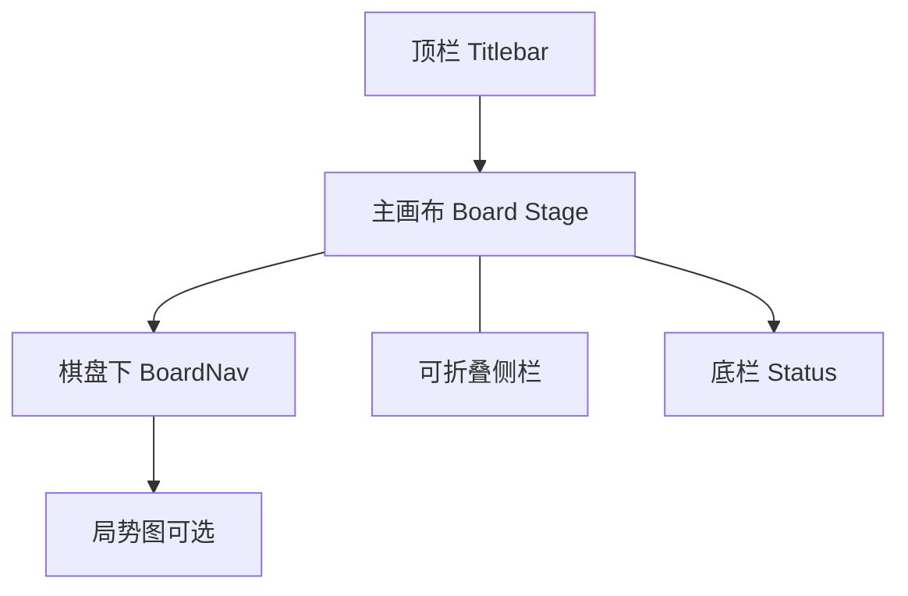

# 象棋X 设计简报（美工 + 前端一次性交齐 · 仅桌面）

面向视觉与前端的交接文档。**范围：桌面端 only**（不含移动）。视觉气质由美工定稿；信息架构槽位与核心流程须保留。

**交付目标**：美工与前端一次性交齐全量可预览页面文件（§7 每一项均有对应页/态），工程侧再挂接业务逻辑。本文以**页面目录**为主，定位与功能作索引，避免漏屏。

相关产品文档（实现细节）：[ui-principles.md](./ui-principles.md) · [interaction-patterns.md](./interaction-patterns.md) · [play-vs-engine.md](./play-vs-engine.md) · [game-review.md](./game-review.md) · [game-library.md](./game-library.md) · [licensing.md](./licensing.md) · [user-guide.md](./user-guide.md)

---

## 1. 产品定位

| 项 | 内容 |
|----|------|
| 名称 | **象棋X / XiangqiX** |
| 一句话 | 桌面象棋**分析宿主**（棋盘复盘 + 本机 UCI 引擎），不是游戏大厅、不是在线对战平台 |
| 引擎 | 安装包**不捆绑**引擎；推荐一键安装 Pikafish；无引擎时正式壳不静默假分析 |
| 门禁 | 无注册门禁 |

产品事实（非风格指令）：分析工具宿主；盘面须中国象棋可读。简报只写本产品能力。

---

## 2. 范围

- **唯一平台**：桌面（Tauri 2 + React），Windows / Linux 正式交付面
- **不写**：移动端布局、底栏导航、Flutter 预览屏

---

## 3. 桌面信息架构（槽位，须保留）

### 3.1 顶栏（常显 vs 配置）

- 品牌：象棋X / XiangqiX
- 常显文案按钮（建议序）：开始分析 ↔ 停止分析 · 推演 · 编辑（下拉）· 连线
- 配置入口（图标）：引擎 / 显示 / 连线 / 关于
- 命令面板入口：`Ctrl/Cmd+K` + ⌘ 图标（加速层，**不替代**常显按钮）
- 模式态额外：退出推演 / 退出人机 / 立即走棋 / 偷看思路（人机中）

### 3.2 主画布

- 棋盘优先、分析信息密度克制
- 可选左侧评估条（EvalBar）
- 棋盘反馈：选中环、合法点（空位点 / 吃子环）、上一手轨迹、MultiPV 箭头、将军提示
- 坐标：盘内路数（顶 1–9 / 底 九–一；翻转换边；视觉样式由美工定）

### 3.3 棋盘下 BoardNav

- 导航：开局 · ±10 · 逐步 · 自动回放/暂停 · 速度 · 末手
- **翻转** · **新开一局**（总面板：分析 / 人机 / 导入）
- 不进顶栏与「编辑」并列

### 3.4 侧栏（可折叠）

- **棋谱**：当前局主线（推演中为支线）；点击跳 ply；质量角标（棋谱分析后）
- **棋谱分析面板**：档位 / 进度取消 / 简报 / 失误（待命无大「开始」主按钮）
- **引擎面板**：推荐着法 + 通俗局势语 + MultiPV 列表；**不重复**开停开关
- 收起后画布右缘把手展开

### 3.5 底栏 Status

- 引擎/模式状态、局面摘要、错误提示；信息克制

### 3.6 全局浮层

- 命令面板、配置对话框（多 Tab）、新开总面板、各类编辑/导入 sheet、引擎安装向导

---

## 4. 功能清单（按模块，桌面）

### A. 棋盘与局面

- 点选走子、非法反馈、走子动画与音效（可关）
- 翻转棋盘；界面字号档位（标准 / 大 / 特大）
- 深 / 浅外观主题（整窗）
- FEN 导入/导出；从图片识别局面（本地）
- **摆子模式**（库存轨、仅将帅开局后摆）

### B. 实时分析

- 开始/停止分析；持续 / 限时 / 限深度
- MultiPV + 棋盘箭头（主强次弱）；停分析须清箭头
- 侧栏推荐/候选；点击进入推演首着
- 评估条；HashFull 等次要数字

### C. 推演

- 分叉沙盒、不改主谱；采用 / 退出；`Space` 走最佳着
- 模式 chrome（rim + 顶栏高亮）

### D. 人机对弈

- 开局向导：红 / 黑 / 随机、难度档、可选当前局面
- 仅人方可走；立即走棋；悔棋；偷看思路可选
- 终局 → 分析本局

### E. 棋谱分析（整局）

- 浅 / 标准批处理；局势图点跳；开 / 中 / 残简报；失误列表
- 与「开始分析」分轨；入口：命令面板 / 人机终局

### F. 棋谱与库

- 会话棋谱回放（含**自动回放**；勿与连线「自动走棋」混淆）
- 历史对局 / 棋谱库 / 收藏；PGN 导入导出；编辑棋局元数据

### G. 连线（实验 / 平台相关）

- 配置 · 连线；观棋分析；方案 / 平台（天天 / JJ 等）；与推演 / 人机互斥

### H. 配置与关于

- 引擎常用 / 高级、显示（主题 / 字号 / 音效）、连线、关于 / 更新 / 外链

---

## 5. 关键状态机（须出模式态）

| 模式 | 壳层信号 | 互斥要点 |
|------|----------|----------|
| 分析（默认可走） | 普通 chrome | 回放进行中不每手重开分析 |
| 推演 | 淡 rim + 「退出推演」高亮 | 锁盘或人机中不可进 |
| 人机 | 淡 rim + 「退出人机」；顶栏改立即走棋等 | 禁推演 / 连线 |
| 摆子 | 右侧库存轨 | 禁推演 / 人机 / 连线 / 回放 |
| 连线观棋 | 锁盘提示 | 禁并行人机 / 推演等 |
| 棋谱分析运行中 | 进度 / 取消 | 占用引擎 |

---

## 6. 硬约束 vs 视觉主导权

**视觉以美工为准**：色彩、材质、字体、控件形态、深浅主题、棋盘 / 棋子画风、图标体系、动效气质等——本文**不规定风格方向**，不把现有工程外观当目标稿。

**仍须遵守的非风格硬约束**（产品 / 可用性）：

- 盘面必须是**中国象棋**可读结构（汉字子、楚河汉界、九宫）；不能做成国际象棋棋盘换皮
- **信息架构槽位与核心交互流程**按上文保留（分析能力如选中 / 合法点 / 箭头 / 评估条须有对应表面；具体视觉语言由美工定）
- 前端文件命名 / token 前缀按 §8，便于工程接入（不等于锁定现有配色）
- 资源须自有或许可清晰；不嵌入第三方专有皮肤包

工程现状外观不作为设计要求。

---

## 7. 全量页面 / 状态清单（一次性交齐）

下列每一项须具备：**用途说明、关键控件、深 / 浅各一态**（可注明同源换 `data-theme`）。前端包用同 ID 建页：`apps/desktop/design/pages/<id>.html` + 索引页。

实现侧参考组件（注释进页面即可）：见 `apps/desktop/src/components/` 与 `App.tsx` 壳层。

### A. 壳层与主屏

| ID | 页面 / 态 | 用途 | 关键控件 / 内容 |
|----|-----------|------|------------------|
| `shell-analysis` | 默认分析主屏 | 日常分析与复盘主界面 | 顶栏（品牌、开始分析、推演、编辑、连线、配置、命令面板）+ 棋盘 + 评估条 + BoardNav + 侧栏（棋谱 / 引擎）+ 底栏 |
| `shell-sidebar-collapsed` | 侧栏收起 | 放大棋盘 | 画布右缘展开把手；侧栏隐藏 |
| `shell-explore` | 推演模式 | 沙盒试走 | 「退出推演」高亮、棋盘 rim、棋谱角标「推演」、「采用到主线」 |
| `shell-play` | 人机对弈 | 引擎代走一方 | 立即走棋 / 偷看思路 / 退出人机；仅人方可选子；棋谱角标「人机」；底栏提示 |
| `shell-play-thinking` | 人机引擎思考中 | 等待引擎回手 | 同上 + 「立即走棋」主按钮强调态 |
| `shell-setup` | 摆子模式 | 自由摆子 | 右侧库存轨（黑左红右份数）；清空保留将帅 / 初始棋盘 / 行棋方 / 完成 / 取消 |
| `shell-review-running` | 棋谱分析进行中 | 整局批处理 | 局势图占位或进度；侧栏档位 + 取消；底栏进度 |
| `shell-review-done` | 棋谱分析完成 | 复盘结果 | 可点局势图；侧栏开 / 中 / 残简报 + 失误列表 + 重新分析 |
| `shell-connect-watch` | 连线观棋锁盘 | 跟外部客户端局面 | 锁盘提示；顶栏 / 侧栏连线相关态 |
| `shell-browser-preview` | 浏览器预览 | 无本机引擎时的预览壳 | 品牌旁「预览」徽章 |

深 / 浅：至少 `shell-analysis` 出齐两主题；其余可注明「同结构换 `data-theme`」。

### B. 棋盘组件板

| ID | 用途 | 关键内容 |
|----|------|----------|
| `board-kit` | 棋盘视觉与交互态合集（可拼图） | 开局满子；选中 + 合法空点 / 吃子环；上一手轨迹；MultiPV 主 / 次箭头；将军；翻转后坐标（顶 1–9 / 底 九–一）；红黑子全套；评估条均势 / 红优 / 黑优 / 杀棋 |

对应组件：`Board.tsx`、`EvalBar.tsx`。

### C. 顶栏与菜单

| ID | 用途 | 关键内容 |
|----|------|----------|
| `titlebar-analysis` | 分析开停 | 开始分析 ↔ 停止分析 |
| `titlebar-edit-menu` | 编辑下拉 | 新开或导入…、编辑棋局、收藏棋局、编辑局面、从图片识别 |
| `titlebar-play-extras` | 人机专用 | 立即走棋、偷看思路、退出人机 |

### D. 棋盘下 BoardNav

| ID | 用途 | 关键内容 |
|----|------|----------|
| `boardnav-idle` | 着法导航待命 | 开局 / ±10 / 逐步 / 回放·暂停 / 速度慢中快 / 末手 / 翻转 / 新开一局 |
| `boardnav-replay` | 自动回放中 | 「暂停」高亮；与连线「自动走棋」文案区分 |
| `eval-graph` | 整局局势图 | 红优曲线、点击跳 ply、红上 · 黑下 |

对应：`BoardNav.tsx`、`EvalGraph.tsx`。

### E. 侧栏面板

| ID | 用途 | 关键内容 |
|----|------|----------|
| `sidebar-moves` | 当前会话棋谱 | 「开始」+ 着法行；摘要红 vs 黑 · 结果可点；收藏；推演时「采用到主线」 |
| `sidebar-moves-review-badges` | 质量角标 | 优 / 良 / 中 / 差 / 错 |
| `sidebar-engine-idle` | 引擎待命 | 「等待引擎输出…」；配置齿轮（无开停开关） |
| `sidebar-engine-live` | 分析输出 | 局势语 + 推荐行 + MultiPV 列表（可点进推演） |
| `sidebar-game-review` | 棋谱分析侧栏 | 档位浅 / 标准；进度 / 取消；简报；失误空态「未发现差 / 错着」；完成后「重新分析」 |

对应：`MoveList.tsx`、`EnginePanel.tsx`、`GameReviewPanel.tsx`。

### F. 浮层 / 对话框（各一完整页）

| ID | 用途 | 关键内容 |
|----|------|----------|
| `dlg-command-palette` | 命令面板 | 搜索框、结果列表、键盘提示、无匹配空态 |
| `dlg-engine-onboard` | 首次启用引擎 | 一键安装、我已有引擎、官方下载页、稍后 |
| `dlg-newgame-analysis` | 新开 · 分析 | 标准开局 / 仅将帅后摆子 / 编辑 FEN… |
| `dlg-newgame-play` | 新开 · 人机 | 我方红 / 黑 / 随机、难度档、从当前局面开始、开始 / 取消 |
| `dlg-newgame-import` | 新开 · 导入 | 粘贴区、导入到当前、选 PGN、识图、打开棋谱库 |
| `dlg-fen-edit` | 编辑局面 | FEN 文本、应用 / 取消、错误提示位 |
| `dlg-pgn-import` | 导入棋谱（会话） | 粘贴、应用、打开库 |
| `dlg-image-board` | 从图片识别 | 平台方案、下一手、选图 / 粘贴、格参、成功 / 失败 |
| `dlg-game-info` | 编辑棋局 | 红 / 黑 / 赛事 / 日期 / 结果 / 地点 / 开局；保存 / 取消；可链编辑局面 / 新开 |
| `dlg-library` | 历史与棋谱库 | 范围分段、筛选（棋手 / 赛事 / 日期 / 结果）、列表、空态「暂无对局」、打开 / 编辑 / 删除 / 收藏、导入导出 |
| `dlg-settings-engine` | 配置 · 引擎 | 一键安装；多变 / 思考方式 / 秒 / 深；人机默认；高级路径 · NNUE · 线程 · 哈希；保存并应用；ⓘ |
| `dlg-settings-display` | 配置 · 显示 | 外观主题深 / 浅、界面字号三档、走子音效 |
| `dlg-settings-connect` | 配置 · 连线 | 内嵌连线面板（见 §G） |
| `dlg-settings-about` | 配置 · 关于 | 版本、检查更新、官网 / 客服 / 下载（可禁用态） |

对应：`CommandPalette.tsx`、`EngineOnboard.tsx`、`NewGameDialog.tsx`、`ImageBoardDialog.tsx`、`GameInfoDialog.tsx`、`GameLibraryDialog.tsx`、`EngineSettings.tsx`；FEN / PGN 对话框在 `App.tsx`。

### G. 连线向导（可嵌在配置 · 连线，须逐步帧）

| ID | 用途 | 关键内容 |
|----|------|----------|
| `connect-mode` | 模式选择 | 观棋（只分析）/ 对弈（可自动走）、轮到红 / 黑、重新对准 |
| `connect-find-window` | 找窗 | 找到象棋窗口、选窗、继续、点一下棋盘窗口 |
| `connect-align` | 对准 | 点红車等指引、刷新预览、下一步 |
| `connect-capture` | 采样 | 拍开局样子、拍摄、保存方案 |
| `connect-running` | 运行中 | 状态、停止 / 自动走相关控件 |

对应：`ConnectPanel.tsx`。

### H. 组件库页

| ID | 用途 | 关键内容 |
|----|------|----------|
| `kit-buttons` | 按钮层级 | 主 / 次 / 模式高亮 / 图标 / 危险 |
| `kit-forms` | 表单控件 | 输入、下拉、勾选、分段、旁注 ⓘ |
| `kit-lists` | 列表 | 行、选中行、角标 |
| `kit-status` | 底栏态 | 引擎可用 / 分析中 / 错误 / 模式提示 |
| `kit-empty` | 空态合集 | 引擎等待、棋谱空、库空、命令无匹配、失误空 |

### 验收

- 索引页列出全部 ID 并可点开
- 缺一页不算交齐
- `shell-analysis` 至少深 / 浅各一帧（或同源可切换）

---

## 8. 前端页面包约定（与稿同步）

| 项 | 约定 |
|----|------|
| 落点 | `apps/desktop/design/`：`index.html` 索引 + `pages/<id>.html` + `tokens.css` + `assets/` |
| 栈 | 静态 HTML/CSS + 少量演示 JS；或同目录 React 静态壳。**不接** UCI / Tauri |
| Token / 类名 | `--xq-*`、`xq-*`；深浅 `html[data-theme="dark\|light"]`（或根节点等价） |
| 映射 | 文件名 = §7 ID；HTML 注释标明对应组件（如 `EnginePanel.tsx`） |
| 交互演示 | 允许悬停、选中、侧栏开合、对话框显隐等纯前端演示 |
| 资源 | 字体 / 图标 / 棋子图用相对路径；许可见 [licensing.md](./licensing.md) |
| 禁止 | 无 ID 映射的巨型单文件；无法对应槽位的平行壳 |

工程后续：样式与结构迁入现有组件（`Board`、`BoardNav`、`EnginePanel`、`CommandPalette`、各 Dialog 等），**保留槽位与 props 行为**。

本简报不创建 `apps/desktop/design/` 目录；由美工 + 前端交件时建立。
